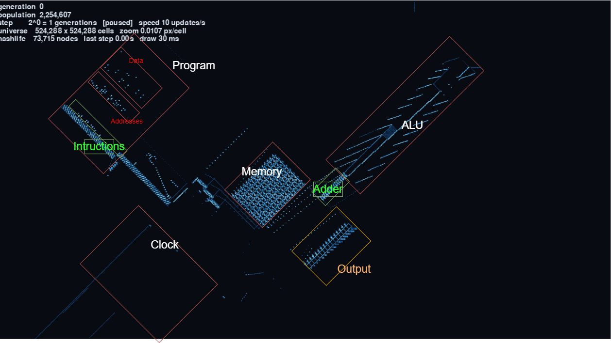

# Game of Life

An interactive Conway's Game of Life simulator powered by a from-scratch
HashLife engine. It uses a memoized quadtree to skip through large numbers of
generations efficiently, while a Pygame viewer renders the currently visible
part of the universe.

The project also includes a MacroCell pattern for a small programmable
computer, plus the program used to run that computer.

## Features

- Fast HashLife simulation for large and long-running patterns
- Interactive Pygame viewer with zooming and panning
- Vectorized NumPy rendering
- RLE and MacroCell (`.mc`) pattern loading
- Optional gzip-compressed pattern files (`.gz`)
- Built-in Gosper glider gun, glider, R-pentomino, acorn, pulsar, and
  lightweight spaceship patterns
- Generation, population, step size, universe size, and performance
  information displayed in the viewer
- Screenshot saving from inside the viewer

The engine currently runs the standard Conway rule **B3/S23**.

## Requirements

- Python 3
- NumPy
- Pygame

Install the dependencies with:

```bash
python -m pip install numpy pygame
```

## Running the viewer

Start with the built-in Gosper glider gun:

```bash
python viewer.py
```

Load a pattern from a file:

```bash
python viewer.py patterns/collatz67.mc
```

The viewer also accepts RLE files and gzip-compressed files:

```bash
python viewer.py path/to/pattern.rle.gz
```

Useful command-line options:

```text
--j J              Start with steps of 2^J generations
--size WIDTHxHEIGHT
                   Set the window size (default: 1280x800)
--max-nodes N      Compact the HashLife universe above N nodes
--rate RATE        Playback updates per second; 0 means unlimited
--run              Start running immediately
```

For example:

```bash
python viewer.py patterns/collatz67.mc --j 4 --size 1600x900 --run
```

['Overview'](/screenshots/overview.png)

## Viewer controls

| Input | Action |
| --- | --- |
| `Space` | Run or pause |
| `N` or `Right Arrow` | Advance one step |
| `Up` / `Down` | Increase or decrease the step size |
| `[` / `]` | Decrease or increase playback speed |
| Mouse wheel | Zoom around the cursor |
| Left-drag | Pan the view |
| `F` | Fit the whole pattern |
| `R` | Reset to generation 0 |
| `S` | Save a PNG screenshot |
| `H` | Show or hide help |
| `Esc` or `Q` | Quit |

The step size is shown as `2^j`, so a single viewer step can advance many
generations when `j` is increased.

## Project layout

```text
hashlife.py                 HashLife engine and pattern loaders
viewer.py                   Pygame interface and renderer
patterns/collatz67.mc       MacroCell computer pattern
screenshots/                Example screenshots
test_viewer.py              Viewer-related tests
```

## The programmable computer
[](./explanations.png)
The computer architecture used by the pattern was designed by
[Nicolas Loizeau](https://github.com/NicolasLoizeau). The implementation,
simulation, viewer, and the program below were built by me.

This is the program used to program the computer:

```text

program = """
# Initialize variables
write a1 67
write a2 0
write a4 1
write a5 0
write a6 0

# Start the Collatz loop
goto 6

# Check if n is equal to 1
# a5 = a1 - a4
# For n=67: a5 = 67 - 1 = 66
- a5 a1 a4

# a5 = 1 if a5 == 0, otherwise a5 = 0
# This means a5 = 1 when n == 1
=0 a5 a5

# If a5 == 1, skip the next instruction
# If n == 1, go to the infinite loop at line 10
# Otherwise, continue to the parity check at line 11
jump a5

# n is not 1, so continue checking whether it is odd or even
goto 11

# n == 1: stop the program by looping forever
goto 10

# Check whether n is odd or even
# a6 = a1 AND 1
# If the result is 1, n is odd
# If the result is 0, n is even
and a6 a1 a4

# If a6 == 1, skip the next instruction
# Odd numbers go to line 14
# Even numbers execute the goto instruction below
jump a6

# Even number: go to the division-by-2 instructions
goto 19

# ODD CASE: calculate 3n + 1

# Shift n left by one bit
# This multiplies n by 2
# a2 = 2n
<< a2 a1

# Add the original n
# a2 = 2n + n = 3n
+ a2 a2 a1

# Add 1
# a1 = 3n + 1
++ a1 a2

# Display the new Collatz value
print a1

# Restart the Collatz loop
goto 6

# EVEN CASE: calculate n / 2

# Shift n right by one bit
# This divides an even number by 2
>> a1 a1

# Display the new Collatz value
print a1

# Restart the Collatz loop
goto 6
"""

```

The corresponding computer pattern is available at
[`patterns/collatz67.mc`](patterns/collatz67.mc).


The computer can be seen in these screenshots that is calculating the Collatz sequence for 67 correctly:

[](./screenshots/first_calculation.png)
[](./screenshots/second_calculation.png)
[](./screenshots/third_calculation.png)

## Credits

- **Computer architecture:** [Nicolas Loizeau](https://github.com/NicolasLoizeau)
- **Everything else in this repository:** built by me
